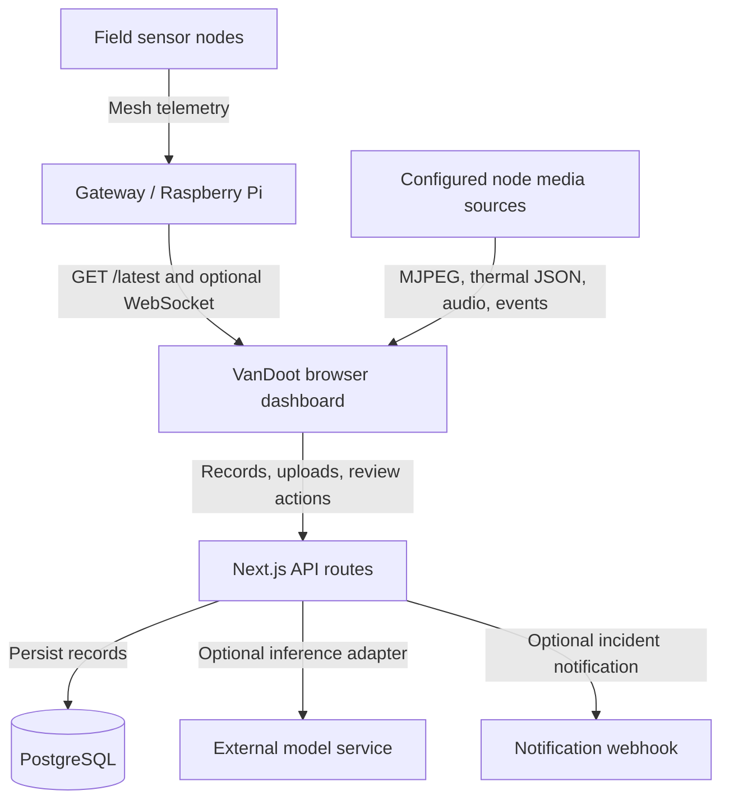

<div align="center">

# VanDoot

**Forest monitoring · Node media · Evidence review**

A forest monitoring control room that connects environmental telemetry, camera feeds, thermal frames, and sound observations to the nodes and incidents that need attention.

[Open Dashboard](https://van-doot-dashboard.vercel.app/) · [Quick Start](#quick-start) · [Hardware](#hardware-and-sensor-support) · [Documentation](#documentation)

**Next.js 16 · React 19 · TypeScript · PostgreSQL · Drizzle · Three.js**

</div>

---

## About the project

VanDoot brings a distributed forest sensor network into one workspace. A ranger can identify an urgent node, inspect the evidence behind an alert, compare nearby sensor readings, and record a review. The interface supports desktop monitoring and phone access, with dark and light themes.

The repository includes an explorable Demo with bundled synthetic media and a Live mode that accepts measurements from a configured gateway. Hardware firmware, the mesh network, and trained models are connected through the documented interfaces.

## Features

| Capability                 | What you can do                                                                                                                                                                 |
| -------------------------- | ------------------------------------------------------------------------------------------------------------------------------------------------------------------------------- |
| **Priority Overview**      | See open critical alerts, online nodes, and telemetry age. Select a map marker to switch the camera and readings to that node.                                                  |
| **Per-node media**         | Configure and test independent ESP32-CAM MJPEG, captured-image, MLX90640 thermal, microphone, and detection-event sources. Open the camera fullscreen and play audio on demand. |
| **Captured evidence**      | Inspect the alert's node, capture time and time zone, matching image/audio, nearby readings, and reported model/version/confidence. Bounding boxes require matching frame IDs.  |
| **Incident review**        | Carry an observation into the protected review workspace, then acknowledge, resolve, or mark it as a false positive with a review note.                                         |
| **Network visibility**     | Explore node details, topology, gateway diagnostics when supplied, sensor trends, system health, and map locations.                                                             |
| **Analysis and reporting** | Filter readings and alerts, inspect chart samples with touch or keyboard, export CSV data, and save reports with PostgreSQL.                                                    |
| **Forest workspaces**      | Test connected image/audio models, import thermal frames, review threats, and manage ranger and model records.                                                                  |
| **3D simulation**          | Explore forest and network scenarios in Three.js. The 3D module loads when its page opens.                                                                                      |
| **Responsive controls**    | Use keyboard search, visible focus states, 44px control targets, reduced-motion styling, and browser Back with restored alert filters.                                          |

The desktop Overview gives the camera two-thirds of its main row. On phones, the urgent alert appears before its node's feed and readings. A priority alert opens its evidence in one click, with **View live now** available from the evidence view.

## Architecture



The gateway adapts field telemetry to the dashboard contract. Camera and audio delivery use configured IP sources, while the gateway handles the field network. Source URLs are configured per node. Provider credentials stay in the Next.js server environment.

| Layer         | Implementation                                                         |
| ------------- | ---------------------------------------------------------------------- |
| Application   | Next.js App Router, React, TypeScript, hash-based workspace navigation |
| Interface     | Shared React components, CSS theme tokens, Tailwind CSS, Lucide icons  |
| Data access   | PostgreSQL, Drizzle ORM, `pg`                                          |
| Telemetry     | Gateway REST polling and optional WebSocket updates                    |
| Visualization | Interactive SVG charts, coordinate map, on-demand Three.js simulation  |
| Verification  | ESLint, TypeScript, contract checks, Playwright                        |

## Demo and Live modes

|                  | Demo                                                                                                        | Live                                                                                               |
| ---------------- | ----------------------------------------------------------------------------------------------------------- | -------------------------------------------------------------------------------------------------- |
| Sensor data      | Generated scenarios and readings                                                                            | Measurements received from the gateway                                                             |
| Media            | Bundled synthetic video, images, audio, and thermal fixtures                                                | Independently configured node sources                                                              |
| Detection events | Scripted examples                                                                                           | Events reported by a connected service                                                             |
| Initial setup    | No hardware or paid API keys                                                                                | Reachable gateway and the attached sources you want to use                                         |
| Persistence      | Full app can save records to PostgreSQL. Static export keeps preferences and alert actions for the session. | PostgreSQL stores application records. Gateway/backend storage supplies durable telemetry history. |

Live node status uses a **30-second freshness window** and requires `online: true`. Missing or future timestamps make a node offline. Unknown current readings display `—`. Evidence retains its capture time and each nearby reading retains its own timestamp, within ±30 seconds of the alert.

The event view distinguishes **No detections received**, **Model disconnected**, and **Model status not reported** according to the service response. A threshold crossing requests human review. Sound classification requires a reported model result.

## Quick start

Use **Node.js 22 or later**, npm, and Git. Start with the bundled Demo, then configure the full app when you need persistence or hardware connections.

### 1. Get the source

```bash
git clone https://github.com/gauravchauhan5721/VanDoot-dashboard.git
cd VanDoot-dashboard
npm ci
```

### 2. Run the standalone Demo

```bash
node scripts/build-preview.mjs
node scripts/serve-preview.mjs --port 4173
```

Open **http://localhost:4173**. The preview is generated from the application source into `dist/`. Its export contains the UI and bundled media. Database, inference, and other API-backed operations require the full Next.js app below.

### 3. Configure the full app

Create a PostgreSQL database and copy the environment template.

**Windows PowerShell**

```powershell
Copy-Item .env.example .env
```

**macOS / Linux**

```bash
cp .env.example .env
```

Set `DATABASE_URL` in `.env`. Set a private `FOREST_ADMIN_TOKEN` if you will use the forest workspaces. For a fresh development database, create the Drizzle tables.

```bash
npx drizzle-kit push
```

Execute [migrations/001_forest.sql](migrations/001_forest.sql) against the same database using your PostgreSQL client or provider's SQL console. This adds the forest record table and index. Review schema changes separately when upgrading an existing database.

Start the app.

```bash
npm run dev -- --port 3000
```

Open **http://localhost:3000**. Windows development uses Webpack by default. For a local production build, run `npm run build`, then `npm start -- --port 3000`.

### Environment variables

| Variable                      | Purpose                                                                                         |
| ----------------------------- | ----------------------------------------------------------------------------------------------- |
| `DATABASE_URL`                | PostgreSQL connection for settings, alert actions, command history, reports, and forest records |
| `FOREST_ADMIN_TOKEN`          | Server access token for forest records, inference, and notification endpoints                   |
| `AI_SERVICE_URL`              | Optional model service base URL. The server appends `/predict`.                                 |
| `AI_SERVICE_TOKEN`            | Optional bearer token sent to the model service                                                 |
| `ALERT_WEBHOOK_URL`           | Optional endpoint for sending a saved incident notification                                     |
| `ALERT_WEBHOOK_TOKEN`         | Optional bearer token sent to the notification provider                                         |
| `NEXT_PUBLIC_GATEWAY_API_URL` | Optional public default for the gateway base URL                                                |
| `NEXT_PUBLIC_GATEWAY_WS_URL`  | Optional public default for the WebSocket URL                                                   |

Gateway defaults can also be changed under **Settings → Connectivity**. Keep database and provider secrets in server environment variables. The workspace access token is entered in the UI and retained in page memory. Earlier settings, alerts, and reports APIs use the existing access model, so deployments that require private access should protect the whole application with authentication.

## Hardware and sensor support

| Measurement or source    | Hardware / input                                   | Dashboard representation                                      |
| ------------------------ | -------------------------------------------------- | ------------------------------------------------------------- |
| Temperature and humidity | DHT22 / AM2302                                     | °C and %, with an optional temperature display conversion     |
| Fine particles           | PM2.5 sensor connected through the gateway         | µg/m³                                                         |
| Gas / smoke response     | MQ-2                                               | Raw ADC reading                                               |
| Motion                   | PIR sensor                                         | Motion / clear                                                |
| Sound intensity          | Analog sensor reading or microphone-derived level  | Raw intensity value                                           |
| Camera                   | ESP32-CAM or compatible MJPEG source               | Live stream and fullscreen view                               |
| Thermal                  | MLX90640                                           | Exact 32 × 24 frame, per-pixel temperature, and min/max scale |
| Audio                    | Microphone plus gateway audio adapter              | On-demand playback of a browser-supported stream or recording |
| Additional telemetry     | Gateway-reported pressure, AQI, battery, RSSI, SNR | Shared sensor cards, charts, and logs                         |

Temperature and humidity can come from one DHT22 module. The PM2.5, PIR, and microphone models are selected by the hardware implementation. AQI must be supplied by the gateway's calculation. MQ-2 and raw sound values retain their raw units.

### Connect a node

1. Expose **`GET /latest`** on the gateway as a dictionary keyed by node ID. Supply `online`, a current UTC `received_at` timestamp, and measured numeric fields. The adapter also accepts Unix-second `last_seen` timestamps.
2. Enter the gateway base URL in **Settings → Connectivity**, save it, and switch to **Live**. The app appends `/latest` to this URL. Add the optional WebSocket endpoint if available.
3. Open **AI Camera & Sound**, select the node, and choose **Configure & test sources**. Save only the camera, image, thermal, audio, and event URLs that the node provides.
4. Open a received event to review its captured evidence, or select **View live now** to return to the current feed.

The Settings connection-test button currently probes `/gateway` and expects an object with an `id`. A gateway implementing only `/latest` can supply live telemetry while that separate diagnostic reports a failure.

Each media source runs independently. Per-node URLs retain the `vandoot-media-demo` and `vandoot-media-live` browser storage keys. Switching nodes cancels old media requests, and transport changes clean up telemetry subscriptions.

An HTTPS deployment needs browser-reachable, compatible HTTPS/WSS endpoints and appropriate CORS for fetched JSON. A computer on the sensor network can run the full app locally for LAN sources. Full payload examples and evidence-frame matching rules are in [MEDIA_SETUP.md](MEDIA_SETUP.md) and [FOREST_WORKSPACE_SETUP.md](FOREST_WORKSPACE_SETUP.md).

## Project structure and customization

| Change                                           | Where to make it                                                                                                                                                                    |
| ------------------------------------------------ | ----------------------------------------------------------------------------------------------------------------------------------------------------------------------------------- |
| Colors, fonts, and both themes                   | [src/app/globals.css](src/app/globals.css) owns the shared tokens                                                                                                                   |
| Control room layout                              | [src/app/control-room.css](src/app/control-room.css), with shared refinements in [polish.css](src/app/polish.css)                                                                   |
| Add a sensor, unit, or gateway alias             | [src/config/sensors.ts](src/config/sensors.ts)                                                                                                                                      |
| Change default warning/critical thresholds       | [src/config/thresholds.ts](src/config/thresholds.ts), with saved overrides in Settings                                                                                              |
| Add a Demo node                                  | [src/config/nodes.ts](src/config/nodes.ts)                                                                                                                                          |
| Add a physical node                              | Publish its unique ID and measurements in gateway `/latest`                                                                                                                         |
| Change a camera, thermal, audio, or event URL    | **AI Camera & Sound → Configure & test sources**                                                                                                                                    |
| Change the gateway URL                           | **Settings → Connectivity**, or public defaults in [src/config/api.ts](src/config/api.ts)                                                                                           |
| Add a page                                       | Navigation in [src/config/dashboard.ts](src/config/dashboard.ts), routing in [src/components/Dashboard.tsx](src/components/Dashboard.tsx), screen in [src/features/](src/features/) |
| Reuse dashboard data and controls                | [useDashboard.tsx](src/hooks/useDashboard.tsx) and [ui.tsx](src/components/ui.tsx)                                                                                                  |
| Extend source setup, rendering, or event history | Focused components and contracts in [src/features/media/](src/features/media/)                                                                                                      |
| Change persistence and server integrations       | [src/app/api/](src/app/api/), [src/db/](src/db/), and [migrations/](migrations/)                                                                                                    |
| Map physical node IDs into the 3D view           | [src/features/simulation/liveAdapter.ts](src/features/simulation/liveAdapter.ts)                                                                                                    |

<details>
<summary><strong>Worked example — add a measured CO₂ sensor</strong></summary>

Add an entry to the `sensors` array in `src/config/sensors.ts`.

```ts
{
  id: "co2",
  name: "CO₂",
  hardware: "Your calibrated CO₂ sensor",
  unit: "ppm",
  precision: 0,
  min: 350,
  max: 2000,
  color: "#74c2d5",
  aliases: ["co2", "co2_ppm"],
  featured: true,
}
```

The gateway can now report `co2_ppm: 610` alongside `online: true` and a current `received_at` for that node. The alias maps to `co2`, and the shared registry supplies units and labels to cards, chart selectors, and logs. `featured: true` includes it in Overview readings and the trend selector.

If needed, add a review threshold in `src/config/thresholds.ts`.

```ts
co2: { warning: 1000, critical: 1500, direction: "above" },
```

These numbers illustrate configuration. Choose operational limits for your sensor and site. New default thresholds merge with existing saved settings. Add an alias and threshold-boundary check to `scripts/test-contracts.mjs` when extending the adapter.

</details>

## Deployment

The hosted dashboard is available at **[van-doot-dashboard.vercel.app](https://van-doot-dashboard.vercel.app/)**. The repository's `main` branch is connected to Vercel.

For a full deployment, use the **Next.js** project preset and the `npm run build` command. Configure PostgreSQL and the required environment variables on the host, and apply both database schemas. Add AI or notification credentials when connecting those services.

For a static Demo deployment, run `node scripts/build-preview.mjs` and publish `dist/` to a static host. Use the full Next.js deployment for server routes and persistent records. The `.openai/hosting.json` file describes the separate Sites static-export configuration.

## Development and verification

| Command                                      | Purpose                                                       |
| -------------------------------------------- | ------------------------------------------------------------- |
| `npm run dev -- --port 3000`                 | Start development                                             |
| `npm run lint`                               | Run ESLint                                                    |
| `npm run typecheck`                          | Check TypeScript                                              |
| `npm run test:contracts`                     | Validate telemetry, media, inference, and threshold contracts |
| `npm run build`                              | Build the full Next.js application                            |
| `npm start -- --port 3000`                   | Serve the production build                                    |
| `npm run test:e2e`                           | Run Playwright against a running test app                     |
| `node scripts/build-preview.mjs`             | Export the standalone Demo                                    |
| `node scripts/serve-preview.mjs --port 4173` | Serve the exported Demo locally                               |

Playwright writes settings, alerts, commands, reports, and incidents. Use a **disposable test database** with both schemas applied. Set a test-only `FOREST_ADMIN_TOKEN` on the app server and in the test runner to exercise authorized review actions. Install a browser with `npx playwright install chromium`, or set `PLAYWRIGHT_CHROMIUM_EXECUTABLE` to an installed Chrome executable. `PLAYWRIGHT_BASE_URL` defaults to `http://localhost:3000`.

The control-room verification run recorded **18 passing Playwright tests** and checks at **360px, 768px, and 1440px** in both themes. Coverage included keyboard navigation, alert → evidence → Back, independent media sources, stale readings, disconnect/reconnect, and incident review. Database tests used PGlite with PostgreSQL 17.5 through a local wire-protocol bridge. See [VERIFICATION.md](VERIFICATION.md) for the dated results and environment details.

## Implementation status

The dashboard, source adapters, synthetic Demo, record persistence, and review workflows are implemented. Live operation depends on a configured gateway, reachable media sources, and any model services the installation uses. Physical ESP32-CAM, MLX90640, microphone, mesh, model accuracy, and native PostgreSQL deployment still require field verification.

Three.js scenarios and the AI/Intelligence risk view remain simulated. Hardware commands require a gateway implementation. Model registry entries hold metadata, and trained weights are supplied externally. Notification actions record provider acceptance, with recipient delivery checked at the provider.

Telemetry history is bounded to the current session, including 5,000 history points, 2,000 log rows, and 200 media events. Save important observations as incidents and use a gateway/backend archive for durable telemetry. Drone and eFOREST integration remain future work.

## Documentation

| Guide                                               | Contents                                                                  |
| --------------------------------------------------- | ------------------------------------------------------------------------- |
| [Node media setup](MEDIA_SETUP.md)                  | Source URLs, thermal/event payloads, captured evidence, Demo assets       |
| [Forest workspace setup](FOREST_WORKSPACE_SETUP.md) | Model service contract, workspace access, notifications, gateway payloads |
| [Verification report](VERIFICATION.md)              | Recorded test results, responsive checks, fixtures, and hardware limits   |
| [Database migration](migrations/001_forest.sql)     | Forest record storage and index                                           |

## Contributing

Open an issue with the affected page, expected behavior, and steps to reproduce. For changes, create a branch, keep sensor definitions and aliases in the shared registry, and run the checks relevant to your change. Hardware integration contributions should include a sanitized sample payload and the gateway or sensor model used for verification.

[Report an issue](https://github.com/gauravchauhan5721/VanDoot-dashboard/issues) · [View pull requests](https://github.com/gauravchauhan5721/VanDoot-dashboard/pulls)

**Maintainer:** [gauravchauhan5721](https://github.com/gauravchauhan5721)

**License:** A license file has not yet been added. Contact the maintainer for reuse and redistribution permissions.
