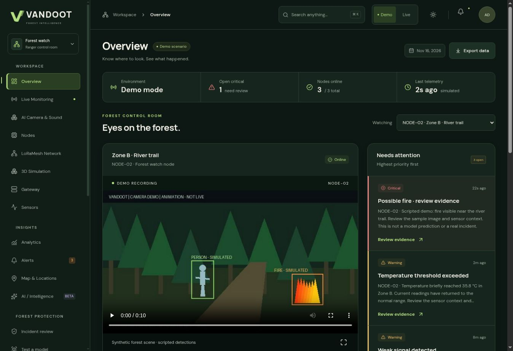
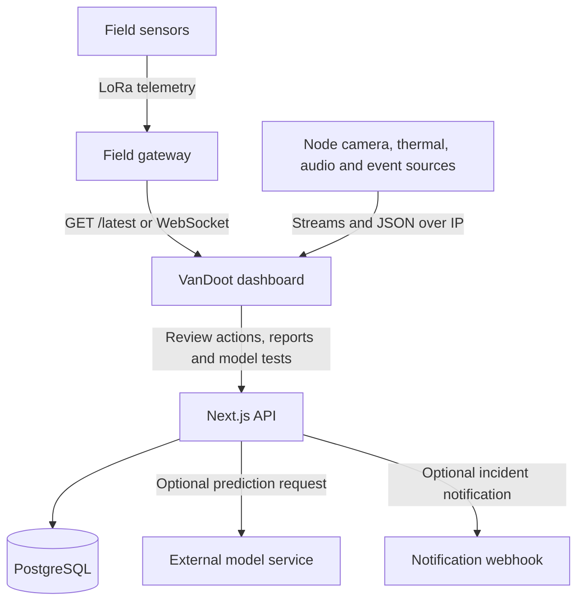

# VanDoot · Forest Monitoring Dashboard

VanDoot helps forest rangers investigate possible fires and unusual activity across a network of sensor nodes. Each alert identifies the reporting node and time. A ranger can compare sensor readings with any captured image or audio, check the current feed and record a decision.

**[Explore the hosted demo](https://van-doot-dashboard.vercel.app/)** · [Run the demo locally](#quick-start) · [Connect a field node](#connect-a-field-node) · [Developer guides](#documentation)



*The river-trail scenario in Demo mode. The camera recording, readings and alert are synthetic.*

## Quick start

The repository includes a prebuilt demo with its own media. You only need Git and Node.js 22 or later to run it.

```bash
git clone https://github.com/gauravchauhan5721/VanDoot-dashboard.git
cd VanDoot-dashboard
node scripts/serve-preview.mjs --port 4173
```

Open the [local dashboard](http://localhost:4173) and follow the river-trail alert.

1. In **Overview → Needs attention**, open **Possible fire · review evidence** for **NODE-02**, the river-trail node.
2. Inspect the captured image and play the attached audio. **Sensor context near capture** shows available readings from within 30 seconds of the event, each with its own timestamp.
3. Select **View live now** to open that same node’s camera, thermal frame and microphone player. On a configured server, **Open incident review** lets a ranger save the observation and acknowledge it, resolve it or mark it as a false positive.

## Demo and Live modes

| What you are looking at | Demo | Live |
| --- | --- | --- |
| Field conditions and network | Three simulated nodes with sample locations, sensor trends and radio links. | The gateway supplies measurements, node status, coordinates and radio metrics. |
| Camera, thermal and audio | Bundled recordings and a generated 32 × 24 thermal frame. | Each node has independent camera, thermal and microphone sources that you configure in the dashboard. |
| Alerts and detections | Scripted scenarios you can open and review. | Sensor thresholds flag readings for review. A connected detection service can report a label, model version, confidence and captured evidence. |

**Analytics** and **Data Logs** export readings as CSV. In the full application, PostgreSQL stores settings, reports and incident review history. Live telemetry stays in the current session. Use a gateway or backend archive for long-term sensor records.

## Architecture



The field installation supplies its node firmware, radio gateway and media endpoints. The browser reads telemetry from the gateway and opens the camera, thermal and audio sources over IP. Next.js 16, React 19 and TypeScript power the interface. Drizzle manages dashboard tables in PostgreSQL, and Three.js renders the forest simulation.

## Run the full application

Use the Next.js app for persistent records, protected incident review and server-side integrations.

1. From the cloned repository, run `npm ci`.
2. Copy [.env.example](.env.example) to `.env` with `cp .env.example .env` on macOS/Linux or `Copy-Item .env.example .env` in PowerShell. Set `DATABASE_URL` to your PostgreSQL connection string and choose a private `FOREST_ADMIN_TOKEN` for the forest workspaces. Leave unused provider settings empty.
3. For a **fresh development database**, run `npx drizzle-kit push` to create the dashboard tables. Then execute [migrations/001_forest.sql](migrations/001_forest.sql) in the **same database** with your SQL client to create the forest records table and index.
4. Run `npm run dev -- --port 3000` and open the [local application](http://localhost:3000). To review or save forest records, enter the configured token in the **Workspace access token** field.

<details>
<summary><strong>Optional integrations and deployment</strong></summary>

| Setting | What it connects |
| --- | --- |
| `NEXT_PUBLIC_GATEWAY_API_URL`, `NEXT_PUBLIC_GATEWAY_WS_URL` | Default browser-facing gateway endpoints. You can also set them under **Settings → Connectivity**. |
| `AI_SERVICE_URL`, `AI_SERVICE_TOKEN` | An external image or audio model. Set the base URL of the service. The server appends `/predict` and can send a bearer token. |
| `ALERT_WEBHOOK_URL`, `ALERT_WEBHOOK_TOKEN` | A notification provider for saved incidents. The dashboard records when the provider accepts the request. |

Keep database credentials and provider tokens on the server. The forest token covers forest records, inference and notifications. For a private deployment, protect the whole application with authentication, including the settings, alerts and reports routes.

For the full app, build with `npm run build` and serve with `npm start`, or use the Next.js preset on Vercel with the same environment and database setup. For a static demo, run `node scripts/build-preview.mjs` after `npm ci` and publish the resulting `dist/` directory.

</details>

## Hardware and sensor support

| Source | What the dashboard displays |
| --- | --- |
| DHT22 and PM2.5 sensor | Temperature in °C, relative humidity in %, and fine-particle concentration in µg/m³. |
| MQ-2, PIR and analog sound sensor | Raw gas response and sound intensity in ADC units, plus motion or clear from the PIR. |
| ESP32-CAM | An MJPEG camera feed. A separate image URL can supply a still frame. |
| MLX90640 | A 32 × 24 thermal frame with 768 temperature values in °C and a per-pixel inspector. |
| Microphone | On-demand audio from a browser-playable stream or recording. The gateway can adapt raw device audio. |
| Node and radio telemetry | Battery level, RSSI, SNR and location when the gateway supplies them. |

### Connect a field node

1. Have the gateway expose `GET /latest` as a JSON object keyed by node ID. A node appears online when `online: true` and its timestamp falls within the last 30 seconds. Send UTC time in `received_at` or Unix seconds in `last_seen`. Missing readings appear as `—`. A [sample gateway payload](FOREST_WORKSPACE_SETUP.md#hardware-contract) shows the field names.
2. In the full app, enter the gateway **base URL** under **Settings → Connectivity**. The dashboard appends `/latest`. Add a WebSocket URL if available, choose **Live Mode** under **General**, then select **Save changes**.
3. Open **AI Camera & Sound**, select the node and choose **Configure & test sources**. Add the URLs that node provides. A camera can run on its own while you add thermal, audio or detection events later. See the [media formats and examples](MEDIA_SETUP.md).

The browser must be able to reach the configured sources. For a hosted HTTPS dashboard, use HTTPS/WSS endpoints and allow the dashboard origin on cross-origin JSON requests. The **Test connection** button checks a separate `/gateway` endpoint for an `id`. A gateway that implements only `/latest` can still supply telemetry.

## Documentation

| Task | Reference |
| --- | --- |
| Configure streams, send detection events or match a box to a captured frame | [Node media setup](MEDIA_SETUP.md) |
| Connect a model, manage incidents or send a notification | [Forest workspace setup](FOREST_WORKSPACE_SETUP.md) |
| Add a sensor or change alert limits | [Sensor definitions and aliases](src/config/sensors.ts) · [Default thresholds](src/config/thresholds.ts) |
| Change the dashboard layout or add a page | [Theme and styles](src/app/globals.css) · [Navigation](src/config/dashboard.ts) · [Page routing](src/components/Dashboard.tsx) |
| Add a demo node or map a physical node into the 3D view | [Demo nodes](src/config/nodes.ts) · [3D node mapping](src/features/simulation/liveAdapter.ts) |
| Check test results and field-validation status | [Verification report](VERIFICATION.md) |

<details>
<summary><strong>Contributor example · add a CO₂ sensor</strong></summary>

In the sensor registry, add a definition with ID `co2`, unit `ppm` and aliases `co2` and `co2_ppm`. Set `featured: true` to include it in Overview and the trend selector. A gateway can then send `co2_ppm: 610` alongside that node’s `online` flag and timestamp. To flag elevated values, add site-specific limits in the threshold configuration and cover the new alias and limits in [the contract checks](scripts/test-contracts.mjs).

</details>

For development, run `npm run lint`, `npm run typecheck` and `npm run test:contracts`. The Playwright suite (`npm run test:e2e`) writes application records. Run it against a running app backed by a disposable database with both schemas applied. The [verification report](VERIFICATION.md) documents the browser setup, 18 passing end-to-end tests and layout checks at 360, 768 and 1440 pixels.

The **3D Simulation** can display mapped node readings. Its scenarios and the **AI / Intelligence** risk scores are simulated. Live predictions require an external trained model. Physical sensor calibration, radio coverage and model accuracy still need field validation.

Maintained by [@gauravchauhan5721](https://github.com/gauravchauhan5721). For integration questions, bug reports or reuse inquiries, [open an issue](https://github.com/gauravchauhan5721/VanDoot-dashboard/issues).
